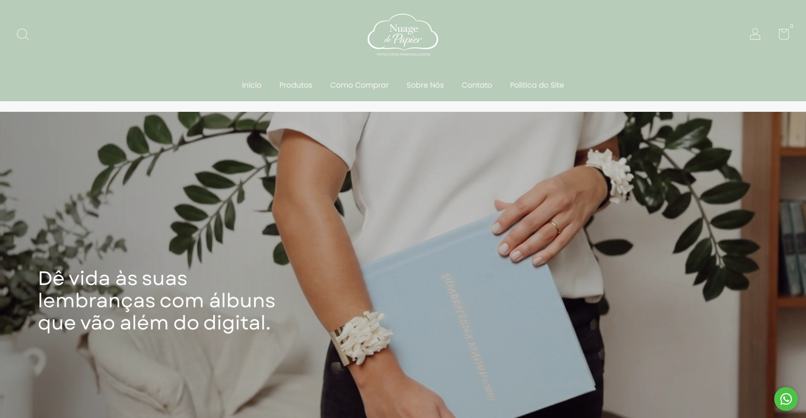
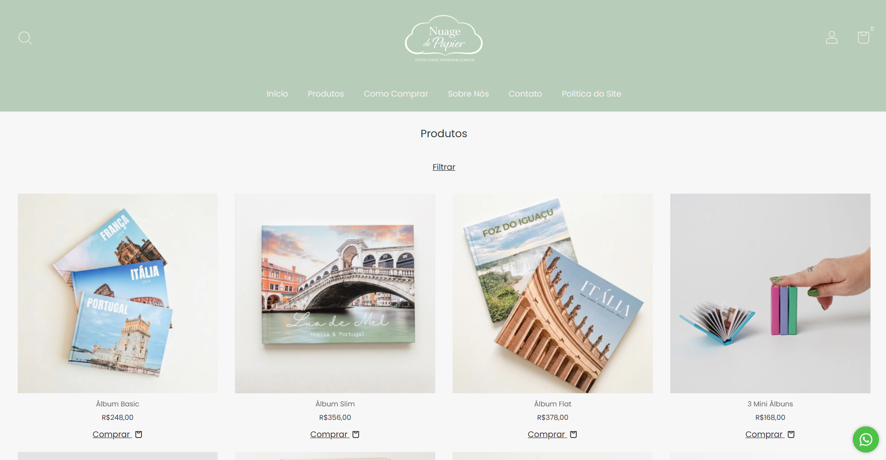
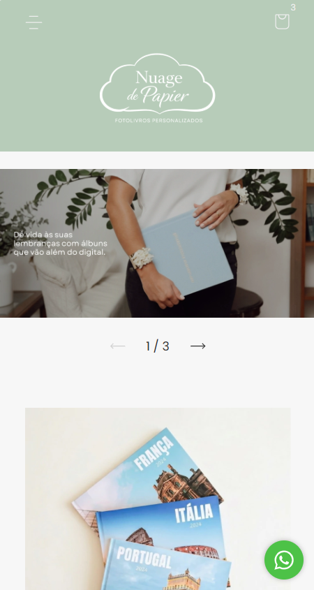

# Nuage de Papier — E-commerce

Projeto de personalização visual e desenvolvimento de interface para uma loja virtual de fotolivros personalizados, utilizando a plataforma Nuvemshop.

🌐 **Site oficial:** https://nuagedepapier.com.br/

## Sobre o projeto

O trabalho consistiu na personalização da experiência visual da loja, buscando transmitir a identidade da marca por meio de um layout elegante, minimalista e responsivo.

Foram desenvolvidas customizações em CSS para ajustar a estrutura das páginas, elementos visuais, tipografia, espaçamentos e apresentação dos produtos.

## Tecnologias e recursos

- HTML
- CSS3
- Flexbox
- Media Queries
- Design Responsivo
- Nuvemshop

## Implementações

- Personalização da identidade visual da loja.
- Ajustes de cabeçalho, navegação e estrutura das páginas.
- Customização de elementos e seções.
- Organização e alinhamento dos componentes com Flexbox.
- Adaptação do layout para dispositivos móveis.
- Ajustes de tipografia, cores e espaçamentos.

## Visualização do projeto

### Página inicial

### Vitrine de produtos

### Versão mobile

## Estrutura do projeto

- `css/custom.css`: código CSS desenvolvido para as personalizações.
- `assets/`: capturas de tela do projeto.

## Observação

Este repositório documenta as personalizações CSS e o resultado visual do projeto. Não contém a exportação completa do tema original da Nuvemshop.

---

Desenvolvido por **Bernardo Ross**.